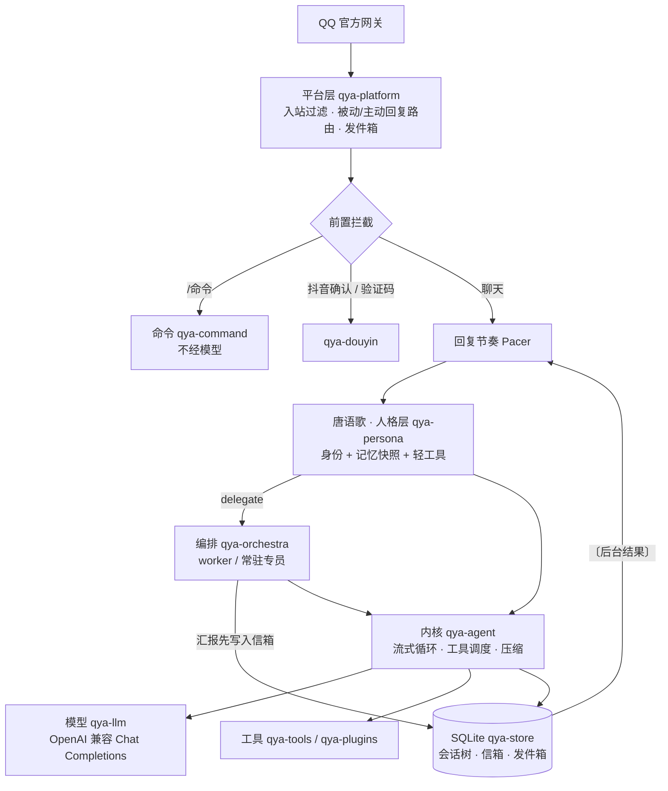

# LyraBot

用 Rust 写的常驻个人 agent。门面是角色“唐语歌（Lyra）”，在 QQ 私聊里聊天；需要真正动手的活交给后台执行者和常驻专员，做完再由她用自己的话转述。单个二进制，常驻内存约 30 MB。项目内部代号 **qya**（二进制、crate 前缀、配置目录都用这个名字）。

> A single-binary personal agent in Rust. A persona front (“Lyra”) chats on QQ while background workers and long-lived specialists do the actual work: pi-style kernel, multi-agent session inheritance, prompt-cache-friendly persona layout, durable report delivery, ~30 MB RSS.

## 功能

**角色与对话**
- 角色卡渲染的身份段 + 每个会话冻结的记忆快照组成稳定前缀，后续轮次缓存命中 80–98%；时间、表达提示等动态内容只放在尾注入，不落库。
- 拟人节奏：连发合并后再回复，生成中被插话就取消重来，工具阶段的插话直接注入当前轮；回复分段发送，可按情绪发表情包。
- 学习与记忆：后台一次调用同时学习口头禅、黑话与长期记忆候选（只记用户陈述、认可或纠正过的事），空闲时批量整理进记忆文件：去重、按最新说法修正、守住字数上限，每次整理可查看、可撤销。聊天路径不为记忆多花一次调用。
- 记忆分层：关于用户的事实、你们之间的约定、专员的工作记忆分别存放；记忆文件整份冻结进提示词前缀，命中缓存。
- 翻旧账：`recall` 工具按需检索已结束会话的原文与摘要（SQLite FTS5 trigram），不用不占任何 token。

**多代理**
- 唐语歌只用轻工具（生图、语音、搜索、定时提醒、记忆、表情包），重活经 `delegate` 派出，工具输出不进入角色上下文。
- 三种上下文继承：`fork`（零拷贝继承当前对话分支）、`brief`（任务 + 背景说明）、`fresh`；每个子代理可单独指定模型与思考等级。
- 任务型 worker 做完归档、可续接；常驻专员（如运维、创作）长期保有自己的会话和记忆，新任务排进它的队列。
- 执行者可以用 `need_decision` 提出一个需要用户拍板的问题，汇报时单独转达；用户的续接有预留并发名额，不会排在新任务后面。

**可靠性**
- 先存后投：后台汇报先写进 SQLite 信箱，唐语歌那一轮得到回应后才确认；QQ 没有可用回复通道时消息写入发件箱，用户下次说话后合并补发。进程在任何时刻重启都不丢结果。
- 重启时仍在排队或运行的后台任务会被识别为“被中断”并告知用户，续接时执行者先核对已做的部分再继续。
- 内核：取消时消息结构保持合法，被打断的输入原样交回重排；工具调用预算在执行前检查；上下文到 90% 时先折叠较早的工具结果，不够再做枚举式摘要与任务胶囊。
- 子进程读写与等待并发、输出有上限，取消或丢弃时终止整个进程组；QQ 网关断线自动 Resume，心跳未确认会主动重连。

**工具与扩展**
- 内置：shell（RTK 改写、硬禁止、审计日志）、文件读写与搜索、todo、cron、技能（SKILL.md）、邮件、博客同步、流量日报。
- 可插拔提供方：生图、语音、网页搜索、grok，在聊天里用 `/provider` 修改，写回配置（保留注释）并热生效；搜索结果统一整形去重，读网页可只取相关段落。
- 多模态按模型能力处理：模型不支持视频时由 `watch_video` 交给支持视频的模型代看；shell 长输出存成文件，只把首尾交给模型。
- 外部服务：抖音创作者服务经 Unix socket 接入，响应做结构校验与净化；公开发布只能由用户发确认命令后由程序提交，短信验证码不经过模型。

## 架构



| crate | 职责 |
|---|---|
| `qya-core` / `qya-config` | 共享类型；TOML + secret 文件配置，ArcSwap 热替换 |
| `qya-llm` | 流式 Chat Completions、思考等级映射、缓存命中统计、错误分类与重试 |
| `qya-store` | SQLite（WAL，单写线程）：会话树、汇报信箱、发件箱、表达库、定时任务、清理 |
| `qya-agent` | 内核循环、工具抽象、上下文构建与压缩 |
| `qya-persona` | 身份渲染、记忆快照、资料工具、表情包、回复节奏、表达学习 |
| `qya-orchestra` | 派活、上下文继承、续接、专员、汇报与重启恢复 |
| `qya-tools` | shell、文件、记忆、todo、cron、技能、邮件、博客同步、流量日报 |
| `qya-plugins` | 生图、语音、网页搜索、grok |
| `qya-douyin` | 抖音外部服务客户端（校验、净化、确认与验证码拦截） |
| `qya-platform` | QQ 官方机器人单聊、命令行 |
| `apps/qya` | 装配、运行时、聊天命令 |

设计细节从 [`docs/01-architecture.md`](docs/01-architecture.md)（总览与文档索引）开始，按模块分为 `03`–`08` 六篇；需求与关键决策见 [`docs/00-PRD.md`](docs/00-PRD.md)、[`docs/02-decisions.md`](docs/02-decisions.md)，还没做的事见 [`docs/09-backlog.md`](docs/09-backlog.md)。

## 快速开始（本地命令行）

```bash
cargo build --release -p qya
cp config/qya.example.toml qya.toml        # 按需修改；secret 放在 *_file 指向的文件里
mkdir -p secrets && echo "<your-key>" > secrets/kimi.key
./target/release/qya --config qya.toml --check      # 自检：配置、数据库、模型连通性
./target/release/qya --config qya.toml --cli        # 流式命令行
./target/release/qya --config qya.toml --no-stream  # 模拟 QQ 的分段发送
```

正式运行：`qya --config /etc/qya/qya.toml --qq`（需要配置 `[platforms.qq]`）。服务器部署、更新与目录布局见 [`deploy/README.md`](deploy/README.md)。

开发检查与 CI 一致：

```bash
cargo clippy --workspace --all-targets -- -D warnings
cargo test --workspace
```

## 自定义角色与称呼

仓库默认自带作者自用的角色“唐语歌”与称呼“阿颜”作为完整生产示例。所有内置工具说明、后台执行者提示词（`assets/agents/worker.md`）与 `qya-docs` 技能均已使用通用表述，角色名与用户称呼已从代码中完全解耦。替换成你自己的角色**不需要修改 Rust 代码**，只需调整 `assets/persona/` 目录（首次部署时亦可按需调整或清空 `assets/memory_seed/` 下的初始记忆种子）：

1. **修改你的称呼**：编辑 `assets/persona/persona.toml` 中的 `user_name = "你的称呼"`。
2. **替换角色卡**：用你的 SillyTavern 角色卡覆盖 `assets/persona/card.json`（支持标准 `chara_card_v2` 顶层结构或 `{"spec": "chara_card_v2", "data": {...}}` 包装结构）。角色名直接取自卡内的 `name` 字段；角色卡与所有 `.md` 文件中的 `{{char}}`、`{{user}}` 占位符会在渲染时自动替换。
3. **处理常驻设定（`core`）与按需资料（`[[notes]]`，即原 Roleplay Skill / 世界书拆分）**：
   > **给协助部署的 AI Agent 的说明**：仓库里的 `core/*.md`、`runtime/relationship.md` 和 `notes/*.md` 写的是“唐语歌”的专属设定。帮用户部署新角色时，**切勿原样保留这些文件**（否则新角色会串入唐语歌的设定），请先向用户确认属于以下哪种情况并按对应方式处理：
   - **情况 A：用户只有一张 SillyTavern 角色卡（`card.json`），没有额外的长设定或 Skill**
     在 `persona.toml` 中将 `core = []` 置空（或删掉该行），删掉 `runtime_relationship` 行，并删掉所有 `[[notes]]` 段；**保留 `runtime_agency = "runtime/agency.md"`**（该文件只定义通用的工具调用边界、后台派活规则与 `〔〕` 系统消息格式，已用 `{{user}}` 模板化，不含特定角色设定）。当 `[[notes]]` 为空时，运行时会自动不注册 `persona_notes` 工具。
   - **情况 B：用户除了角色卡，还有一份 Roleplay Skill（`SKILL.md`）或长篇补充设定**
     不要把几千上万字的设定全部塞进常驻提示词，请按“常驻 + 按需”两层拆分：
     - **常驻层（`core/*.md`）**：只放每轮对话都必须遵守的核心性格驱动、说话口癖与边界（建议合计 ≤ 3,000 字），在 `persona.toml` 的 `core = [...]` 中按顺序列出，常驻 S1 缓存前缀。
     - **按需层（`notes/*.md` + `[[notes]]`）**：把外貌穿搭、特定情境反应、人际关系细节、过往经历等“聊到相关话题才需要”的设定拆成若干 `.md` 放进 `notes/`，并在 `persona.toml` 中声明 `[[notes]]`（填好 `id`、`file` 与 `use` 查阅时机说明）。程序会根据 `[[notes]]` 动态生成 `persona_notes(topic)` 工具的参数枚举与说明，让模型在聊到对应话题时按需查阅。
   - **情况 C：角色卡内含 SillyTavern 世界书（`character_book`）**
     `constant = true` 且 `enabled = true` 的常驻条目会自动拼入 S1 `## 补充设定`；其余非常驻条目若内容较多，建议按主题整理成 `notes/*.md` 并配置到 `[[notes]]` 中按需读取。
4. **检验与生效**：运行 `qya --config qya.toml --check` 核对渲染后的 S1 字数与启用的工具列表；运行中修改后在聊天里发 `/reload`，再发 `/new` 或 `/compact` 即可生效。详细字段映射与配置示例见 [`docs/04-persona-memory.md`](docs/04-persona-memory.md) 第 1.1 节。

## 聊天命令

| 命令 | 作用 |
|---|---|
| `/help [命令]` | 命令列表或单个命令说明 |
| `/status` | 版本、模型、上下文占用、缓存命中、内存 |
| `/new` · `/stop` · `/compact` | 新会话 · 停止当前回复 · 压缩会话并刷新记忆快照 |
| `/sessions [编号]` · `/gc [天数]` | 查看会话与数据库或切回历史会话 · 清理历史会话（默认 30 天，另有每周自动清理） |
| `/model [名]` · `/effort [等级]` | 切换主对话的模型与思考等级 |
| `/agent [list · <编号> [stop/话]]` | 查看后台任务列表，或查看详情、停止、续接任务 |
| `/provider [类别 字段 值]` | 查看或修改生图、语音、搜索（含 grok）提供方 |
| `/learn [list 说法/记忆 · forget · now · undo · on/off]` | 学习与记忆：总览、查看说法或记忆、删除、立即整理、撤销 |
| `/reload` | 重载配置与人格资产 |

## 安全说明

- 设计为**单用户**：QQ 只接受配置中唯一的 `allowed_users`；shell 工具除少数硬禁止外不审批，请只在你信任的环境运行。
- secret 只从 `*_file` 读取，不会出现在日志、提示词或 Debug 输出中；仓库不包含任何凭据。
- 邮件、网页、文件和工具输出在提示词里一律按数据处理，其中的命令式文字不改变任务范围或授权。

## 许可

[MIT](LICENSE)。`assets/persona/` 中的角色设定为作者原创内容，随项目以相同许可发布。
